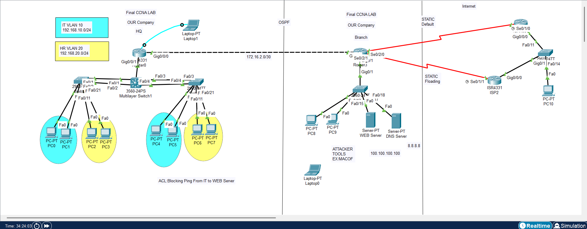

# Final CCNA Lab - Network Design and Configuration

## About This Project
This repository contains my final CCNA lab project, simulated in **Cisco Packet Tracer**. It covers advanced networking concepts including:

- VLANs and Inter-VLAN Routing (Router-on-a-Stick)
- EtherChannel (PAgP and Static)
- OSPF (Single Area)
- NAT (Static and Overload)
- ACL (Extended)
- HSRP (First Hop Redundancy)
- Port Security
- DHCP
- Device Security (Passwords & Banner)

## Repository Structure
- **PacketTracer/**: Contains the `.pkt` file for the lab.
- **Configs/**: Contains the CLI configuration files for all devices.
- **Documentation/**: Contains network diagrams, IP addressing tables, and technology details.

## Lab Contents
Here is a list of the configuration files included in this lab:

| Device | Description | Configuration File |
|---|---|---|
| Core Switch | Multilayer Switch (VLANs, DHCP) | [Core_Switch.txt](Configs/Core_Switch.txt) |
| S1 | Access Switch (VLANs, EtherChannel) | [S1_Switch.txt](Configs/S1_Switch.txt) |
| S2 | Access Switch (VLANs, EtherChannel) | [S2_Switch.txt](Configs/S2_Switch.txt) |
| HQ Router | Router-on-a-Stick, OSPF, ACL, Security | [HQ_Router.txt](Configs/HQ_Router.txt) |
| Branch Router | OSPF, NAT, Default Routing | [Branch_Router.txt](Configs/Branch_Router.txt) |
| ISP1 | HSRP, Static Routing | [ISP1.txt](Configs/ISP1.txt) |
| ISP2 | HSRP, Static Routing | [ISP2.txt](Configs/ISP2.txt) |
| Security | Port Security Configuration | [Security_PortSecurity.txt](Configs/Security_PortSecurity.txt) |

## Documentation
- [IP Addressing](Documentation/IP_Addressing.md)
- [Technologies Used](Documentation/Technologies_Used.md)
- [Network Diagram](Documentation/Network_Diagram.md)

## How to Use
1. Download the `.pkt` file from the `PacketTracer` folder.
2. Open it in Cisco Packet Tracer.
3. Refer to the `Configs` folder for the CLI commands used.

## Technologies Used
- OSPF
- NAT (Static and Overload)
- ACL (Extended)
- HSRP
- Port Security
- VLANs and Trunking
- EtherChannel
- DHCP
- Device Security

## Author
- **olazafrany** - www.linkedin.com/in/ola-zafrany

---
Don't forget to star ⭐ this repository.
